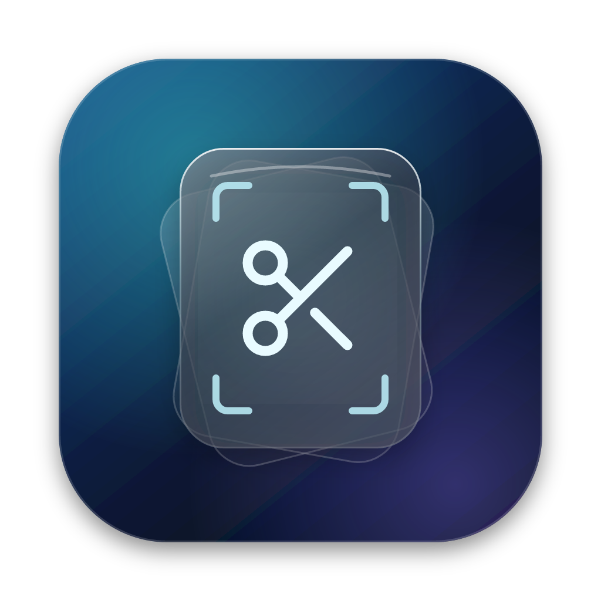

<p align="center"></p>

<h1 align="center">Snipper</h1>

<p align="center">Save posts from X, screenshots, notes and links on your Mac — then find them by meaning.<br>
A native macOS 26 app with Liquid Glass, on-device <b>EmbeddingGemma 2</b> search, and a Chromium extension.</p>

---

## What it does

**Snip anything**
- **Posts from X** — a *Snip* button on every post in Chrome, Arc, Brave, Edge, Vivaldi or any Chromium browser. Saves the full text of long posts, every image and video, quotes, link cards and metrics.
- **All your X bookmarks** — one click scrolls through `x.com/i/bookmarks` and imports everything. Archives, CSV/JSON exports and browser bookmark files import too.
- **Screenshots** — area, window, full screen, or **text** (OCR, copies the text). The selection overlay has a crosshair, pixel loupe with color readout, resize handles, keyboard nudging and click-to-select windows.
- **Annotate** — arrows, boxes, ellipses, lines, pen, highlighter, text, numbered steps, pixelate (redact) and crop, with undo.
- **Pin** screenshots above all windows, or drag them out of the capture preview.
- **Quick note** — a Spotlight-style glass panel from anywhere (⌃⇧N).
- **Snip the browser tab** (⌃⇧X) — no extension needed: reads the front tab of any Chromium browser or Safari and saves the post or page with its preview.
- **Clipboard, Services, drag & drop, color picker, URL scheme** (`snipper://…`).

**Find it again**
- **Semantic search with EmbeddingGemma 2**, Google's multimodal embedding model, running entirely on your Mac with WebGPU. Text and images share one space: search *“chart showing revenue growth”* and get the screenshot, even if the words never appear in it. Post photos are embedded together with their text.
- **Hybrid ranking** blends meaning with keywords, and text inside screenshots is recognized (Vision OCR) and searchable.
- **Search by image** — drop a picture on the search bar. **More like this** on any card.
- Filters: `from:handle` · `tag:name` · `type:post|screenshot|note|link|image|clip` · `is:fav` · `"exact phrase"`.

**Liquid Glass design**
- An *atlas* field like the EmbeddingGemma demo: cards arranged in rings, best match in the center, shrinking toward the edges like a lens; pan, pinch and zoom. Or a masonry *grid*.
- Floating glass search bar with similarity readouts, glass chrome, a focused viewer, and a menu bar panel with every tool.

## Requirements

- macOS 26 (Tahoe) — Liquid Glass and the SwiftUI APIs used here are macOS 26 only
- Xcode 26 or its command line tools (Swift 6.2)
- For semantic search: a Mac with WebGPU in WebKit (Apple silicon recommended) and a one-time ~300 MB model download. Without WebGPU Snipper falls back to Apple's built-in text embeddings.

## Build and run

```bash
make run              # builds build/Snipper.app and opens it
# or
scripts/build-app.sh  # release build, ad-hoc signed
```

macOS ties Screen Recording permission to the code signature, so with ad-hoc signing it asks again after every rebuild. Sign with your development certificate to keep it:

```bash
SIGN_IDENTITY="Apple Development: Your Name (TEAMID)" scripts/build-app.sh
```

Prefer Xcode? `brew install xcodegen && xcodegen` creates `Snipper.xcodeproj` from `project.yml`.

## Install the browser extension

1. Open `chrome://extensions` (or `arc://extensions`, `brave://extensions`, `edge://extensions`).
2. Turn on **Developer mode**, click **Load unpacked**, and choose the `Extension` folder
   (Snipper › Settings › Browser › *Show Extension Folder* opens it).
3. Keep Snipper running. The extension talks to it on `127.0.0.1:47615`.

The extension adds:
- the **Snip** button on posts (click again to remove), with saved posts highlighted;
- **Import X bookmarks** in the popup (or *File › Import X Bookmarks…* in the app);
- right-click **Save selection / link / image / page / screenshot to Snipper**;
- shortcuts **⌥⇧S** (save page or selection) and **⌥⇧A** (screenshot visible area).

Saves made while the app is closed are queued and sent when it starts.

## Shortcuts

| Action | Default |
| --- | --- |
| Capture area | ⌃⇧4 |
| Capture window | ⌃⇧5 |
| Capture screen | ⌃⇧3 |
| Capture text (OCR) | ⌃⇧2 |
| Quick note | ⌃⇧N |
| Snip browser tab | ⌃⇧X |
| Save clipboard | ⌃⇧V |
| Pick color | ⌃⇧C |
| Search library | ⌃⇧Space |

All of them can be changed in Settings › Shortcuts. While selecting an area: **Space** toggles window mode, **Shift** keeps a square, **arrows** nudge (**⌥** resizes), **Return** saves, **S** save · **C** copy · **A** annotate · **T** copy text · **P** pin, **Esc** cancels. In the library: **⌘F** search, **⌘1/⌘2** atlas/grid, **←/→** step through the viewer.

## How search works

```
snip ──► EmbeddingDocument ──► EmbeddingGemma 2 (WebGPU, in a hidden WKWebView) ──► 768-d vector ──► SQLite
query ─► "task: search result | query: …" ─► vector ─► cosine vs all snips ─┐
                                              keywords + filters ──────────┴─► hybrid ranking
```

- The model is [`onnx-community/embeddinggemma-2-ONNX`](https://huggingface.co/onnx-community/embeddinggemma-2-ONNX) (4-bit, text + vision encoders; audio stays unloaded), run with [Transformers.js](https://huggingface.co/docs/transformers.js) 4.3 inside a hidden `WKWebView` (`Sources/Snipper/Resources/gemma-runtime.html`). Files are cached by WebKit after the first download; *Settings › Search* can delete them.
- Documents use the model's prompts (`title: … | text: …`), queries use `task: search result | query: …`. Screenshots are embedded as image + recognized text; post photos join the post text via `<|image|>` placeholders.
- Vectors are re-computed only when a snip's embedding input changes (content hash), newest first, in token-budgeted batches.

## Privacy

Everything stays on your Mac: the library is `~/Library/Application Support/Snipper` (SQLite + media files), and embeddings are computed locally. Network access is limited to downloading the model (Hugging Face, jsDelivr), images and previews of things you save, and X's public embed endpoints when you snip a post URL without the extension.

The local API only listens on the loopback interface. It accepts requests from browser extensions or local tools carrying the `X-Snipper-Client` header; websites can't send that header without a CORS preflight, which Snipper denies.

## Project layout

```
Sources/SnipperCore   Model, SQLite storage, ranking, post/archive/CSV parsing, HTTP parsing (Foundation only)
Sources/Snipper       The macOS app: SwiftUI + AppKit, ScreenCaptureKit, Vision, WebKit
  App/ Library/ Search/ Capture/ Editor/ Browser/ System/ UI/ Resources/
Extension/            Chromium MV3 extension (X content scripts, popup, service worker)
Tests/                XCTest suite for SnipperCore
App/                  Info.plist, entitlements, icon
```

## Tests

```bash
swift test                                  # SnipperCore (also runs on Linux)
node --test "Extension/tests/*.test.mjs"    # the extension's X GraphQL parser
```

## URL scheme

`snipper://search?q=…` · `snipper://capture/area|window|screen|text` · `snipper://note?text=…` · `snipper://save?url=…` · `snipper://import-bookmarks` — handy from Raycast, Alfred or Shortcuts.

---

Icons in the extension and app use the [Lucide](https://lucide.dev) scissors glyph (ISC license).
